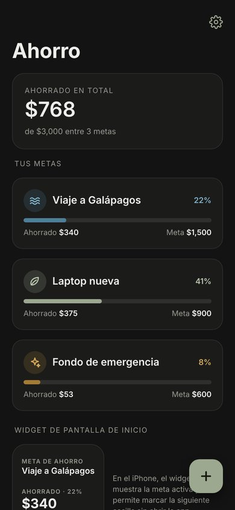
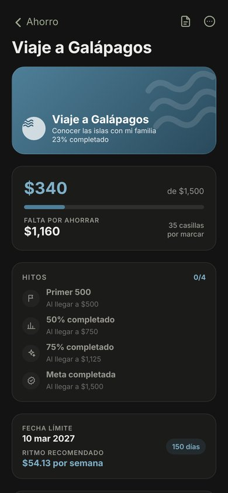
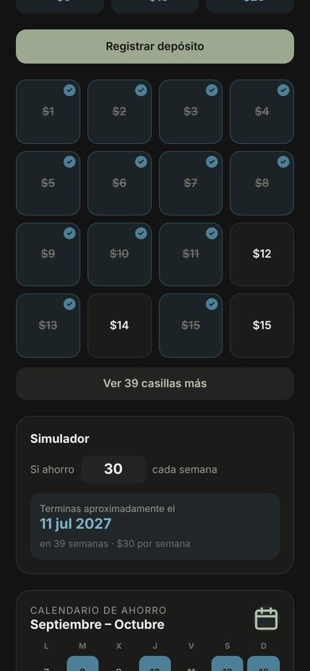
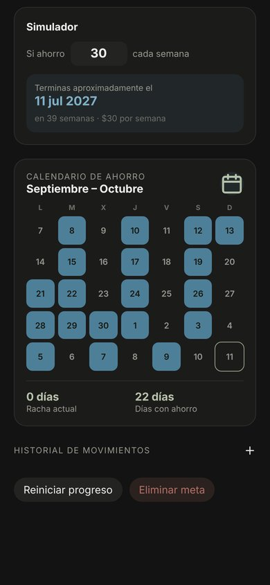

# Ahorro · app de metas de ahorro para iPhone

App nativa para iPhone y iPad hecha con SwiftUI. Convierte una meta de ahorro en una tabla de casillas: cada vez que guardas dinero marcas una casilla y ves cómo avanza tu meta.

**Demo interactiva (versión web, datos ficticios):** [anderssont-var.github.io/AnderssonT-var.github/demos/ahorro/](https://anderssont-var.github.io/AnderssonT-var.github/demos/ahorro/)

> La demo web recrea las pantallas de la app en el navegador para poder probarla sin un iPhone. La app real está en este repositorio, en Swift.

## Capturas

<p>
  
  
  
  
</p>

_Capturas tomadas de la demo web con datos ficticios._

## Funciones

- **Tablas de ahorro:** secuenciales ($1, $2, $3… hasta la meta) o de patrón variado con la cantidad de casillas que elijas.
- **Depósitos:** marcar casillas, depósitos rápidos (+5, +10, +20), depósitos manuales con nota y fecha, y depósitos programados semanales, quincenales o mensuales.
- **Seguimiento:** barra de progreso, hitos (50 %, 75 %, meta completada), gráfico de avance y calendario con racha de días ahorrando.
- **Planificación:** fecha límite con ritmo semanal recomendado y simulador ("si ahorro X por semana, termino el…").
- **Recalcular tabla:** cambia el monto de la meta y redistribuye solo las casillas pendientes, sin tocar lo ya ahorrado.
- **Personalización:** seis temas de color, icono, foto de portada y una frase de motivación por meta.
- **Widget** de pantalla de inicio que muestra la meta activa y permite marcar la siguiente casilla.
- **Face ID / Touch ID** para bloquear la app y **recordatorio inteligente** si llevas días sin ahorrar.
- **Reporte PDF** de una meta o de todas.
- **Monedas:** USD, MXN y EUR. Modo claro, oscuro o automático.

## Tecnologías

Swift · SwiftUI · WidgetKit · App Intents · LocalAuthentication · UserNotifications · PhotosUI · QuickLook · CloudKit (preparado)

## Estructura

```
Ahorro/
├── AhorroApp.swift            Modelos, almacenamiento y pantallas principales
├── GoalPlanningViews.swift    Fecha límite, depósitos programados y edición
├── GoalEnhancements.swift     Hitos, depósito rápido, simulador y recálculo
├── GoalAppearanceSupport.swift Temas, iconos y portadas
├── GoalProgressChart.swift    Gráfico de avance
├── SavingsCalendarView.swift  Calendario y rachas
├── SavingsPDFExporter.swift   Reporte PDF
├── SettingsView.swift         Ajustes
├── AppSettings.swift          Preferencias, Face ID y recordatorios
└── CloudKitSyncService.swift  Sincronización con iCloud (desactivada por defecto)
AhorroWidget/                  Widget de pantalla de inicio
```

## Cómo ejecutarla

1. Abre `Ahorro.xcodeproj` en Xcode.
2. En **Signing & Capabilities**, elige tu propio equipo de desarrollo (Team) en los dos targets: `Ahorro` y `AhorroWidgetExtension`.
3. Si cambias el identificador del app group (`group.com.personal.Ahorro`), actualízalo también en los archivos `.entitlements`.
4. Ejecuta en un simulador o en tu iPhone.

Los datos se guardan en el dispositivo en un archivo JSON. La sincronización con iCloud ya está programada, pero solo se activa al compilar con la condición `CLOUDKIT_SYNC` y una cuenta de Apple Developer de pago.

---
Desarrollado por [Andersson Toapanta](https://anderssont-var.github.io/AnderssonT-var.github/)
